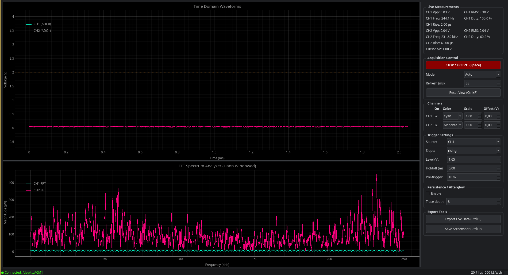

# Pico Scope

A dual-channel USB oscilloscope and spectrum analyzer built on the Raspberry Pi
Pico 2 (RP2350). The firmware streams interleaved ADC samples over USB CDC
serial; a PyQt5/pyqtgraph desktop GUI renders live time-domain and FFT views.



## Features

- Dual-channel capture: CH1 = ADC0 (GPIO26), CH2 = ADC1 (GPIO27), 500 kS/s
  per channel via DMA round-robin sampling
- Built-in ~1 kHz PWM test signal on GPIO15 for quick sanity checks
- Time-domain waveform view with draggable trigger and voltage cursors
- FFT spectrum analyzer (Hann windowed)
- Live measurements per channel: Vpp, RMS, dominant frequency, duty cycle,
  rise time
- Acquisition modes: Auto / Normal / Single, with trigger holdoff and
  pre-trigger position
- Per-channel enable/disable, color, vertical scale and offset
- Persistence / afterglow display mode
- Dark theme, resizable plot/sidebar layout, status bar (connection, fps,
  sample rate)
- Keyboard shortcuts, CSV data export, PNG screenshot export
- Automatic serial reconnect on disconnect

## Hardware

- Raspberry Pi Pico 2 (RP2350)
- Signal(s) under test wired to GPIO26 (CH1) and/or GPIO27 (CH2), 0-3.3 V
- Optional: jumper GPIO15 to CH2 to see the built-in PWM test signal

## Firmware: build & flash

Requires the Pico SDK (see `pico_sdk_import.cmake`) and `picotool`.

```bash
mkdir -p build && cd build
cmake ..
make -j$(nproc)
```

Flash the result (`pico_scope.uf2`) with `picotool`, or by holding BOOTSEL
while plugging in the Pico and copying the `.uf2` to the `RPI-RP2` drive:

```bash
picotool load -f build/pico_scope.uf2
```

## GUI: setup & run

```bash
pip install pyserial pyqtgraph PyQt5 numpy
python3 scope_gui.py
```

By default the GUI connects to `/dev/ttyACM1` — edit `SERIAL_PORT` in
`scope_gui.py` if your Pico enumerates elsewhere (check with `ls /dev/ttyACM*`
and `udevadm info -q property -n /dev/ttyACMx` to confirm which device is the
Pico, since other USB serial devices such as laptop WWAN modems can also show
up as `ttyACM*`).

## Keyboard shortcuts

| Key      | Action              |
|----------|---------------------|
| Space    | Run / Stop          |
| Ctrl+S   | Export CSV          |
| Ctrl+P   | Save screenshot     |
| Ctrl+R   | Reset plot view     |
| 1 / 2    | Toggle CH1 / CH2    |
